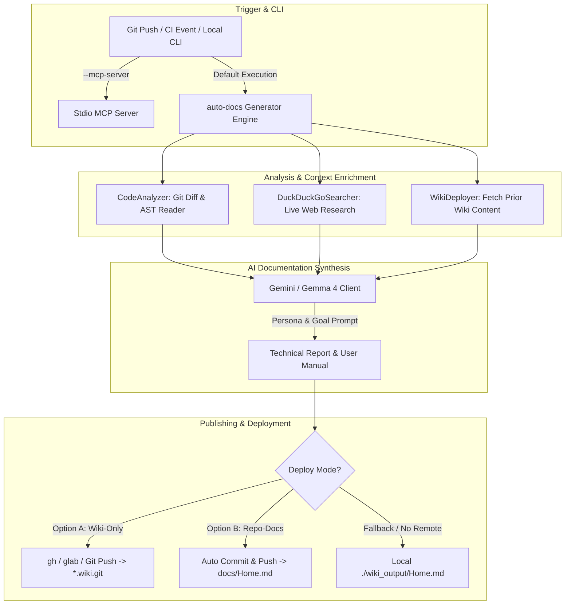

# 🚀 auto-docs

[](https://github.com/mireu-workflow/auto-docs/actions/workflows/auto-docs.yml)
[](https://golang.org)
[](https://modelcontextprotocol.io)
[](https://opensource.org/licenses/MIT)

**auto-docs** is an enterprise-grade AI technical documentation generator and automated deployment engine. Powered by Google AI Studio **Gemma 4 / Gemini**, the **Model Context Protocol (MCP)**, and real-time **DuckDuckGo** technical research, it analyzes your codebase structure, inspects Git diffs, reconciles prior documentation, and automatically publishes comprehensive Markdown user manuals and technical specs to **GitHub / GitLab Wikis**.

---

## 🌟 Key Highlights

- **Seamless Dual Mode**:
  - **Pipeline Mode (Default)**: Automatically analyzes repository diffs, performs live web context enrichment, runs AI synthesis, and publishes to GitHub/GitLab Wikis.
  - **Stdio MCP Server Mode (`--mcp-server`)**: Runs as a standard Model Context Protocol (JSON-RPC 2.0) server over stdio for IDEs, Claude Desktop, and Antigravity Agent tools.
- **Incremental Context Reconciliation**:
  - Automatically fetches previously published Wiki content (`Home.md`) before generation, ensuring existing features are reconciled rather than lost.
- **Metadata & History Tracking**:
  - Tracks and timestamps operational pipeline runs with target Git branches, release tags/versions, and execution times (UTC / KST).
- **Flexible Deployment Strategies (Option A & B)**:
  - **Option A (`wiki-only`, Default)**: Pure Wiki Git repository deployment (`*.wiki.git`) with graceful fallback handling.
  - **Option B (`repo-docs`)**: Automatically commits and pushes generated reports to `docs/Home.md` directly in the source repository if remote Wikis are uninitialized (404).
- **Multi-Platform Support**:
  - Native integration with **GitHub CLI (`gh`)** and **GitLab CLI (`glab`)**, as well as fallback Git transport.
- **Multilingual Support**:
  - Defaults to English (`en`) with on-the-fly override via CLI (`-lang en`, `-lang ko`, `-lang ja`, `-lang zh`).

---

## 🏗️ Architecture



---

## ⚡ Quick Start

### 1. Run via Go CLI

```bash
# Clone the repository
git clone https://github.com/mireu-workflow/auto-docs.git
cd auto-docs

# Export your Google AI Studio / Gemini API Key
export GEMINI_API_KEY="your-gemini-api-key"

# Generate documentation in English (Default)
go run main.go

# Generate documentation in Korean or other languages
go run main.go -lang ko

# Run with Option B (Fallback directly into docs/Home.md)
go run main.go -mode B
```

### 2. Run as an MCP Server

Integrate `auto-docs` directly into Claude Desktop or Antigravity by adding it to your MCP configuration:

```json
{
  "mcpServers": {
    "auto-docs": {
      "command": "/usr/local/bin/auto-docs",
      "args": ["--mcp-server"],
      "env": {
        "REPO_PATH": "/path/to/your/workspace"
      }
    }
  }
}
```

#### Available MCP Tools

| Tool Name | Description |
| :--- | :--- |
| `git_diff_analyzer` | Analyzes repository Git diffs and changed file lists |
| `filesystem_reader` | Reads code files with size limit safety |
| `read_file` | Reads exact line ranges of specific code files |
| `code_search` | Performs symbol and regex queries using git grep |
| `duckduckgo_search` | Real-time web search for framework/library technical context |

---

## ⚙️ Configuration & Environment Variables

| Variable | Description | Default |
| :--- | :--- | :--- |
| `GEMINI_API_KEY` | Google AI Studio / Gemini API Key (Required for AI generation) | *None* |
| `GITHUB_TOKEN` | GitHub Token for authenticated Wiki deployment | `${{ github.token }}` in Actions |
| `GITLAB_TOKEN` | GitLab Token (`PROJECT_ACCESS_TOKEN` / `GITLAB_WIKI_TOKEN`) | *None* |
| `GEMINI_MODEL` | Target Gemini / Gemma model | `gemma-4-26b-a4b-it` |
| `DOCS_LANGUAGE` | Output documentation language (`en`, `ko`, `ja`, `zh`, etc.) | `en` |
| `DEPLOY_MODE` | Deployment strategy: `A` (`wiki-only`) or `B` (`repo-docs`) | `A` |
| `WIKI_REPO_URL` | Explicit target Wiki Git URL | *Auto-detected from CI context* |
| `WIKI_TYPE` | Platform type (`github` or `gitlab`) | `github` |
| `REPO_PATH` | Path to the repository root | `.` |

---

## 🔄 CI/CD Automation

### GitHub Actions (`.github/workflows/auto-docs.yml`)

```yaml
name: auto-docs Wiki Generator

on:
  push:
    branches: [ main, master ]
  workflow_dispatch:

jobs:
  build-and-generate-docs:
    runs-on: ubuntu-latest
    permissions:
      contents: write  # Required for repository & wiki push

    steps:
      - name: Checkout Source Code
        uses: actions/checkout@v4
        with:
          fetch-depth: 0

      - name: Setup Go
        uses: actions/setup-go@v5
        with:
          go-version: '1.26'

      - name: Build auto-docs CLI
        run: go build -o auto-docs main.go

      - name: Run auto-docs & Update Wiki
        env:
          GEMINI_API_KEY: ${{ secrets.GEMINI_API_KEY }}
          GITHUB_TOKEN: ${{ secrets.GITHUB_TOKEN }}
          GITHUB_REPOSITORY: ${{ github.repository }}
          GEMINI_MODEL: "gemma-4-26b-a4b-it"
          DOCS_LANGUAGE: "en"
        run: ./auto-docs
```

### GitLab CI (`.gitlab-ci.yml`)

Refer to [`examples/gitlab-ci-runner.yml`](examples/gitlab-ci-runner.yml) for full containerized GitLab runner setups.

---

## 📖 Official Wiki

View live, AI-generated documentation created by this repository:
- 🌐 [Official GitHub Wiki](https://github.com/mireu-workflow/auto-docs/wiki)

---

## 🤝 Contributing & License

Contributions, feature suggestions, and bug reports are welcome! Please feel free to open an issue or pull request.

Distributed under the **MIT License**. See `LICENSE` for more information.
